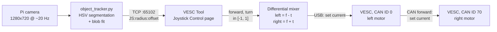

# Self-Driving Skateboard

An electric skateboard that follows a target on its own, using a camera, a small vision pipeline, and two VESC motor controllers driven as a differential (skid-steer) base.

This repository is a fork of [VESC Tool](https://github.com/vedderb/vesc_tool). It adds:

- **A Joystick Control page in VESC Tool** that drives two motors at once (one directly, one over CAN), from the mouse or from an external program.
- **A small TCP control interface** so any process (Python, ROS node, etc.) can stream drive commands into VESC Tool.
- **A proof-of-concept vision stack** that finds a green ball with a Raspberry Pi camera and steers the board to follow it at a set distance.

> **Status: proof of concept.** This is a research prototype, not a product. Read [Safety and known limitations](#safety-and-known-limitations) before putting anyone on the board.

---

## Contents

- [System overview](#system-overview)
- [Hardware](#hardware)
- [Proof-of-concept vision stack](#proof-of-concept-vision-stack)
  - [Perception](#1-perception-object_trackerpy)
  - [Control law](#2-control-law-pagejoystickcontrolcpp)
  - [Differential drive and actuation](#3-differential-drive-and-actuation-directionaljoystickcpp)
- [The TCP control protocol](#the-tcp-control-protocol)
- [Getting started](#getting-started)
- [Tuning](#tuning)
- [Safety and known limitations](#safety-and-known-limitations)
- [Roadmap](#roadmap)
- [Repository layout](#repository-layout)
- [Contributing](#contributing)
- [License and trademark](#license-and-trademark)

---

## System overview



The work is split into three stages, each in its own place:

| Stage | Where | What it does |
|---|---|---|
| Perception | `object_tracker.py` | Turns camera frames into a raw measurement of the target: apparent size and horizontal offset |
| Control | `pages/pagejoystickcontrol.cpp` | Turns that measurement into normalized `forward` and `turn` commands |
| Actuation | `widgets/directionaljoystick.cpp` | Mixes `forward` and `turn` into per-motor current setpoints and sends them to both VESCs |

Perception and actuation run in **separate processes** connected by a plain-text TCP socket. This split is deliberate. See [Why a TCP bridge](#why-a-tcp-bridge-instead-of-talking-to-the-vesc-directly).

---

## Hardware

The reference build uses:

- **Two VESC-based motor controllers**, one for the left motor and one for the right, linked over **CAN bus**. VESC Tool connects to one of them over USB (CAN ID `0` by default) and reaches the other (CAN ID `70` by default) by CAN forwarding.
- **A Raspberry Pi** with a **Pi camera** (accessed with `picamera2`), running both the tracker and VESC Tool.
- **A green ball** (or any green object) as the target.

The CAN IDs, current limit and deadzone can all be changed on the Joystick Control page.

---

## Proof-of-concept vision stack

### 1. Perception (`object_tracker.py`)

Each frame goes through:

1. **Color segmentation in HSV.** The frame is converted to HSV and thresholded to hue 35–85 with saturation and value at 50 or above. HSV separates color (hue) from brightness (value), so one hue band holds up much better under changing light than an RGB threshold would.
2. **Morphological cleanup.** Two erosions and then two dilations with a 5×5 kernel. Erosion removes speckle noise, and dilation restores the size of what is left. This is an *opening*, which keeps solid blobs and removes isolated pixels.
3. **Target selection.** The largest external contour is taken to be the target. A minimum enclosing circle gives its **radius**, and image moments give its **centroid**. The moment centroid is used instead of the circle center because it is less affected by partial occlusion.
4. **Gating.** Detections with a radius outside 10–200 px are thrown out as noise (too small) or a background region (too large).

The tracker sends two numbers about 20 times a second:

- `radius`: the apparent size of the target in pixels
- `offset / 100`: the horizontal distance of the centroid from the image center, in hundreds of pixels (positive means the target is right of center)

If nothing is detected, it sends `JS:0:0`, which the control stage reads as "no target, stop".

**Why these two measurements are enough.** For a pinhole camera and a target of known physical radius `R` at distance `Z`, the apparent radius is `r ≈ f·R / Z`. Apparent size is therefore a monocular **range** estimate, inversely proportional to distance. Because the controller only compares the radius to a setpoint, this needs no depth sensor and no camera calibration. Likewise, the horizontal pixel offset `u ≈ f·tan(θ)` grows monotonically with the **bearing** `θ` to the target. Range and bearing are all a planar pursuit controller needs.

### 2. Control law (`pages/pagejoystickcontrol.cpp`)

VESC Tool runs a small TCP server (`TcpServerSimple`) on port `65102`. Each incoming `JS:` line is turned into normalized commands by `onTcpDataReceived`:

```
forward = clamp( (r_ideal - r) / r_ideal / k_forward , -1, 1 )   if r > 0, else 0
turn    = clamp( (offset/100)        / k_turn    , -1, 1 )
```

- **Forward is a proportional distance controller.** `r_ideal` (the *Ideal Ball Size*, 45 px by default) is the apparent size at the following distance you want. A target smaller than that is too far away, so `forward` is positive and the board moves closer. A larger target is too close, so the board backs off. At the setpoint `forward = 0` and the board holds station. Dividing by `r_ideal` makes the error **relative**, so the same gain behaves similarly whatever setpoint you pick.
- **Turn is a proportional bearing controller.** Any offset from the image center produces a turn command that grows with the offset, which steers the target back to the center.
- **The scales `k_forward` and `k_turn` are the inverse gains.** Larger values make the board respond more gently. With both at `1.0`, the board turns at full strength once the target is 100 px off center.

This is pure P-control on both axes, with no integral or derivative term. That is deliberate for a first prototype: it has nothing to tune beyond two gains and a setpoint, and it is easy to reason about. See the [Roadmap](#roadmap) for planned improvements.

### 3. Differential drive and actuation (`widgets/directionaljoystick.cpp`)

The normalized commands go into `DirectionalJoystick::setExternalControl`, which:

1. Moves the on-screen joystick handle to match, turning it **red** while it is under TCP control.
2. Applies the deadzone, then rescales so the full output range is still available outside it.
3. Mixes the commands for the two sides ("arcade drive"):

   ```
   left  = clamp(forward - turn, -1, 1)
   right = clamp(forward + turn, -1, 1)
   ```

4. Sends `left × I_max` to the primary VESC and `right × I_max` to the secondary VESC as **motor current** setpoints. `I_max` is *Max Current*, 10 A by default. If both `|forward|` and `|turn|` are under 0.1, both motors are commanded to 0 A.

**Why differential (skid) steering.** A skateboard normally steers by leaning, which bends the trucks. A self-driving board has no rider to lean it, so it steers like a tank instead: one side is driven harder than the other. This needs no steering actuator and makes heading directly controllable from software. The cost is tire scrub during turns.

**Why current control instead of duty cycle or speed.** Commanding current means commanding **torque**:

- Torque sets acceleration, so a step in the command becomes a smooth change in speed instead of a jerk. That matters on a board that might carry a person.
- Negative current is **regenerative braking**, so the same command handles both slowing down and reversing.
- The drive stays *compliant*. If a wheel hits an obstacle it will not push through at a fixed duty cycle, and current is bounded by `I_max` by construction.

The vision loop is closing a loop on *position* (range and bearing). Using torque as the actuator input gives a cascade that is naturally damped by the board's inertia and rolling resistance.

**Why one USB link and CAN forwarding.** VESC Tool talks to the primary controller over USB. For the secondary motor, it temporarily points its command stream at CAN ID 70 (`setSendCan(true, 70)`), sends the setpoint, and restores the previous target. The primary VESC passes the packet on over CAN. The result is one serial link to the computer, synchronized commands to both sides, and no second USB port or driver needed.

**Keep-alive.** The page sends a VESC *alive* packet every 200 ms while the **Keep Alive** box is checked. This stops the VESC's own command timeout from cutting the motors between control updates. See the warning about this under [Safety](#safety-and-known-limitations).

### Why a TCP bridge instead of talking to the VESC directly

- **Process isolation.** If perception crashes or is restarted, the VESC connection, its configuration and the motor-control code are unaffected.
- **Any language, any machine.** Anything that can open a socket can drive the board: Python, a ROS node, a phone, or a laptop on the same network (`--host`).
- **One place for safety and mixing.** Clamping, deadzone, mixing, CAN routing and current limits all live in one place. Clients send only *intent* (`forward`, `turn`), never raw motor commands.
- **You can see what it is doing.** The joystick widget shows what the autonomy stack is commanding in real time, which is very useful when debugging on the bench.

---

## The TCP control protocol

- **Transport:** TCP, default port `65102` (set on the Joystick Control page)
- **Framing:** one message per line, newline-terminated, UTF-8
- **Message:** `JS:<a>:<b>\n`

The server currently reads `<a>` and `<b>` with the ball-following semantics described above: `<a>` is the target radius in pixels (`0` means no target) and `<b>` is the scaled horizontal offset. The generic joystick client `python_joystick_client.py` sends normalized values in `[-1, 1]`. Because the server always applies the ideal-size transform to `<a>`, the generic client needs a different *Ideal Ball Size* or a separate message type to drive forward correctly. Making these two semantics explicit is on the [Roadmap](#roadmap).

---

## Getting started

### 1. Build and run VESC Tool

Build with qmake as for upstream VESC Tool (Qt 5 required). On Linux:

```shell
qmake -config release "CONFIG += release_lin build_original exclude_fw"
make -j8
```

On macOS, `./run_vesc_tool.sh` cleans, builds and opens the app. `./run_vesc_tool.sh linux` builds for Linux. A Nix flake (`nix run`, `nix develop`) is also provided for x86 Linux.

### 2. Configure the Joystick Control page

1. Connect to the primary VESC over USB.
2. Open **Joystick Control** in the page list.
3. Set **Primary Motor CAN ID** and **Secondary Motor CAN ID**. Use `-1` for the controller connected directly over USB.
4. Set a conservative **Max Current** for first tests, with the wheels off the ground.
5. Turn on **TCP Server** and check that the status reads *Listening on port 65102*.

### 3. Run a client

Vision, on the Raspberry Pi:

```shell
pip install opencv-python numpy picamera2
python3 object_tracker.py --host localhost --port 65102
```

A preview window shows the detection. Press `q` to quit.

Manual control, for testing:

```shell
python3 python_joystick_client.py --mode keyboard
python3 python_joystick_client.py --mode joystick
```

You can also drag the on-screen joystick with the mouse. While the main window has focus, `W`/`S` and `A`/`D` drive the secondary motor (CAN ID 70) directly for bench tests.

---

## Tuning

| Parameter | Where | Effect |
|---|---|---|
| Ideal Ball Size | Joystick page | Following distance. Larger means closer. |
| TCP Forward Scale | Joystick page | Inverse forward gain. Raise it if the board surges or oscillates back and forth. |
| TCP Turn Scale | Joystick page | Inverse turn gain. Raise it if the board weaves from side to side. |
| Max Current | Joystick page | Hard limit on motor torque |
| Deadzone | Joystick page | Size of the zero band around the center |
| `lower_green` / `upper_green` | `object_tracker.py` | HSV color band for the target |
| `min_radius` / `max_radius` | `object_tracker.py` | Size gate for detections |

Suggested order: tune the HSV band until the preview shows a single clean detection. Then set *Ideal Ball Size* by placing the ball at the distance you want and reading the size shown in the preview. Then raise the gains (lower the scales) from gentle until the response is brisk but does not overshoot.

**Turn direction depends on how your motors are configured.** If the board turns *away* from the target, invert the motor direction on one VESC (in its motor configuration) or swap the CAN IDs.

---

## Safety and known limitations

This is an experimental robot with enough torque to hurt someone. Do first tests with the wheels off the ground, keep the current limit low, and always have a way to cut power that does not depend on software.

Known limitations of the current prototype:

- **The TCP-loss failsafe is unreliable.** The 500 ms "external control timed out, stop motors" check runs only when the joystick widget redraws, and redraws are triggered by incoming messages. Meanwhile **Keep Alive** keeps the VESC's own timeout from firing. If the tracker crashes or the connection drops, **the motors can keep running at the last commanded current**. Until this is fixed, use the VESC's own timeout with Keep Alive turned off, or keep a physical kill switch within reach.
- **Updates are event-driven.** In TCP mode, motor commands are sent only when a message arrives. The 50 ms update timer runs only during mouse control.
- **Single-color, single-target perception.** The largest green blob wins. Other green objects, grass or changes in lighting can take over the target. There is no tracking or filtering between frames.
- **Pure P-control with no filtering.** Detection noise goes straight into the motor commands.
- **Some values are hard-coded.** The frame width (1280 px) is fixed in the tracker, and the CAN IDs in the `W`/`A`/`S`/`D` shortcuts are hard-coded to 70.
- **The protocol is overloaded.** The same `JS:` message means different things to the vision client and the generic client (see above).

---

## Roadmap

- [ ] A proper watchdog: a timer-driven stop that runs whether or not the widget redraws, plus a heartbeat in the protocol
- [ ] Separate message types for normalized joystick commands and raw vision measurements
- [ ] Temporal filtering (EMA or Kalman) on range and bearing, and PD control on bearing
- [ ] Take frame size from the camera configuration instead of hard-coding it
- [ ] Learned detector (for example a small YOLO model) to follow people or other objects
- [ ] Odometry from VESC tachometer feedback, for closed-loop speed control

---

## Repository layout

Files added or significantly changed by this project:

```
object_tracker.py              Vision client: HSV ball detection -> TCP
python_joystick_client.py      Manual client: keyboard / gamepad -> TCP
pages/pagejoystickcontrol.*    Joystick Control page, TCP server, control law
widgets/directionaljoystick.*  Joystick widget, differential mixer, CAN routing
mainwindow.*                   Page registration, W/A/S/D shortcuts for the second motor
run_vesc_tool.sh               Build-and-launch helper
```

Everything else is upstream VESC Tool. See the [upstream repository](https://github.com/vedderb/vesc_tool) for documentation of the rest of the application.

---

## Contributing

Issues and pull requests are welcome, especially for the items on the [Roadmap](#roadmap) and the [known limitations](#safety-and-known-limitations). For a pull request:

1. Explain the robotics reasoning behind a change, not only the code change.
2. Bench-test with the wheels off the ground, and say in the PR how you tested.
3. Keep perception, control and actuation separate. New sensors should talk to VESC Tool through the TCP interface instead of calling into the motor code.

General VESC Tool improvements that are not specific to this project should go to the [upstream project](https://github.com/vedderb/vesc_tool).

---

## License and trademark

Like upstream VESC Tool, this project is licensed under the **GNU GPL v3**. See [LICENSE](LICENSE).

VESC® is a registered trademark of Benjamin Vedder. This repository is an independent fork. It is not affiliated with or endorsed by the VESC Project, and it does not distribute binary releases. See the VESC Project [trademark policies](https://vesc-project.com/trademark_policies). Official VESC Tool binaries are available from [vesc-project.com](https://vesc-project.com/).
